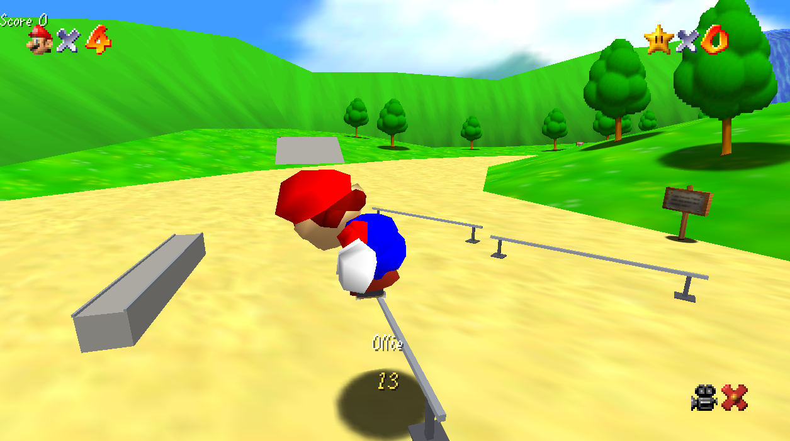

# Skating with a Plumber in a Magical Land

**Skate 64**: Skate 3's skating engine inside Super Mario 64.

This is a mod for [sm64coopdx](https://github.com/coop-deluxe/sm64coopdx) (Super Mario 64 Coop Deluxe). Mario rides the Rust re-implementation of Skate 3's skateboarding engine through the real game: coins, enemies, stars, warps and the rest of Mario 64 keep working around you. Press Y and Mario gets on the board. Press Y again and he's back to his normal moveset.

[](https://ko-fi.com/stewyork91)



> **Version 0.1.0, experimental.** Playable, but tested on one PC. Expect rough edges.

## Features

- **The Skate 3 engine:** flick-it tricks, grinds, manuals, grabs, bails, using the engine's own physics and scoring.
- **Full-body Skate poses on Mario.** The engine's 36-bone skeleton is retargeted onto Mario's 20 body parts every frame, with leg IK so his feet stay on the deck.
- **The whole level is skateable.** Level collision goes straight to the engine, and ledges and edges become grind rails automatically.
- **Session markers, Skate 4 style:** hold D-pad Up to set one, tap Up to go back.
- **Replay editor:** the last 60 seconds, always recording. Play/pause, scrub, slow motion, frame step, four cameras, trick markers on the timeline.
- **Skate trainer menu:**
  - six physics presets and twelve multipliers (ollie height, push speed, grip, wobble...), plus hold fakie
  - Hall of Meat bail control, plus options for knockback and falling off the map
  - noclip, god mode, character select (Mario, Luigi, Toad, Waluigi, Wario)
  - camera distance and field of view
- **Object dropper:** kickers, a big kicker, bank ramp, quarter pipe, funbox, ledge, manual pad and flat rail. Pieces are solid for Mario and the engine, and they're saved per level.
- **Skate 3 board sounds:** rolling and grind loops, pops, landings, pushes, bails. These come from your own copy of Skate 3; none are included here.
- **Trick names and combo chains** on the HUD ("Kickflip + 50-50 + Manual").

## Controls

| Controller | Keyboard | Action |
| --- | --- | --- |
| Y | J | Get on / off the board |
| Right stick flicks, triggers, A push | K ollie, Q/E flicks, WASD | Skate 3 controls |
| Hold D-pad Up | Hold 1 | Set session marker |
| Tap D-pad Up | Tap 1 | Return to marker |
| D-pad Down | 2 | Replay editor |
| D-pad Right | 3 | Skate trainer menu |

Every screen (replay, dropper, menu) shows its own controls along the bottom. Use an XInput controller for the full trick set.

## What you need

You need your own copies of the games. Nothing from Nintendo or EA is included in this repository.

- Windows 10/11 (x64)
- [sm64coopdx 1.5.1](https://github.com/coop-deluxe/sm64coopdx/releases) for Windows
- A Super Mario 64 (USA) ROM dumped from your own cartridge
- Skate 3 (PS3) assets converted for the Rust skate engine, from your own disc (see below)
- To build: Rust (stable), Visual Studio 2022 with C++, Python 3. Optional: [vgmstream](https://vgmstream.org/) and ffmpeg for the sounds

## Setup

1. **coopdx:** extract the sm64coopdx 1.5.1 Windows zip into `game\`, so you have `game\sm64coopdx.exe`. That folder is a private copy; your normal coopdx install and saves are not touched.
2. **ROM:** `python tools\convert-rom.py "<your rom>"` writes `game\user\baserom.us.z64`. It accepts .z64, .v64 and .n64 dumps and checks that the ROM is the US version.
3. **Build:**
   ```
   cargo build --manifest-path host\Cargo.toml
   tools\build-native.cmd
   ```
4. **Skate 3 assets:** the host loads the skater, animations and physics data from a folder of converted Skate 3 assets. The [Skate 3 Rust engine](https://github.com/SK8-ENGINE/skate-3-rust-engine) converts these from your own Skate 3 disc.
5. **Sounds (optional):** with `vgmstream-cli.exe` in `tools\vgmstream` and ffmpeg on your PATH:
   ```
   python tools\import-skate3-sounds.py "<Skate 3>\PS3_GAME\USRDIR\data\audio"
   ```
6. **Play:** the first time, tell the launcher where the assets are:
   ```
   powershell -ExecutionPolicy Bypass -File tools\launch.ps1 -Assets "C:\path\to\skate3\assets"
   ```
   After that, just run **Play Skate 64.cmd**. It hosts a local coopdx game with the mod enabled.

## How it works

- **`native/`:** a small DLL that coopdx loads in place of `discord_game_sdk.dll`; it forwards Discord's functions to the original, renamed DLL. It reads coopdx's `coop.map` to find the built-in Lua runtime, hooks `lua_pcallk`, and registers `sk_*` functions for the Lua mod. It also starts the host and talks to it through shared memory, and retargets the Skate skeleton onto Mario (`rig.h`).
- **`host/`:** the Rust skate simulation (the upstream `skate-host` crate). It builds collision and grind rails from the level, runs the engine at 60 Hz, and publishes the pose, board, camera and score each frame.
- **`mod/sm64-skate/`:** the coopdx Lua mod. It collects level collision, adds the skate action, and handles the board model, camera, HUD, markers, replay, trainer, dropper and sounds.

## Credits

- [2010 Rust Rewrite Mashup](https://github.com/chasmlol/2010-rust-rewrite-mashup) by chasmlol, the Rust Skate 3 engine this runs (Apache-2.0); a fork of [IW4L](https://github.com/vladtrc/iw4L) by vladtrc. See `licenses/` and `THIRD-PARTY.md`.
- [Skate 3 Rust Engine](https://github.com/SK8-ENGINE/skate-3-rust-engine)
- [sm64coopdx](https://github.com/coop-deluxe/sm64coopdx) and its Lua API
- Built with help from Claude (Anthropic).

Unofficial fan project. Not affiliated with Nintendo or EA. Super Mario 64 is a trademark of Nintendo; Skate is a trademark of Electronic Arts.
